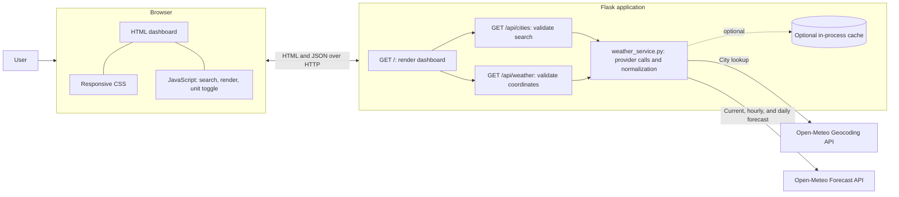
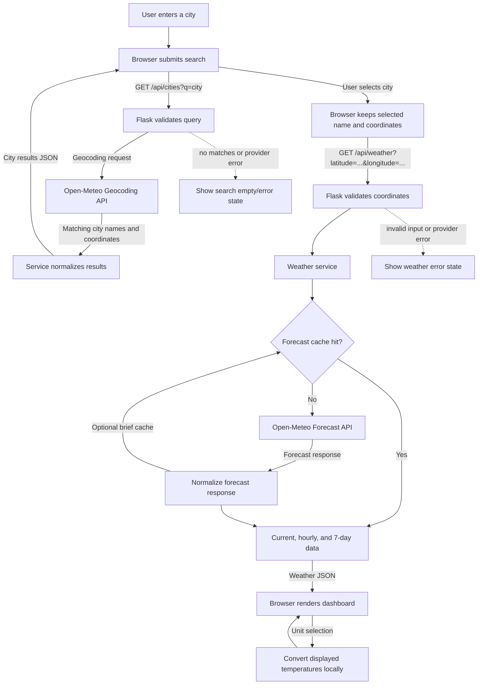

## Plan: Flask Weather Dashboard

Build a responsive browser-based weather dashboard using plain HTML, CSS, and JavaScript with a Flask backend. Use Open-Meteo geocoding and forecast APIs for live city search and weather without API-key setup; route provider calls through Flask.

**Steps**
1. Add minimal Flask and HTTP-client dependencies plus a local run command; keep `app.py` as the Flask entry point.
2. Create a Flask-rendered page template and static CSS/JavaScript assets. Add backend routes for city search and forecast retrieval, validating inputs, applying request timeouts, and returning consistent JSON errors.
3. Use Open-Meteo geocoding to search and select cities. Fetch current conditions, the next 24 hours, and a 7-day forecast using the selected coordinates. Add brief in-process caching if it can be done without extra infrastructure.
4. Implement the browser interaction flow: submit city searches, select a result, load weather asynchronously, render useful loading/empty/error states, and switch Celsius/Fahrenheit consistently.
5. Build a polished responsive dashboard with location and local time, prominent current conditions, supporting weather metrics, an hourly forecast, and a compact 7-day forecast.
6. Verify backend routes and browser behavior, including live results, invalid inputs, no matches, provider/network failures, units, and desktop/mobile layout.

**Relevant files**
- `c:\\co-pilot\\kyndryl\\app.py` — current empty Python entry point; define the Flask app, page/API routes, provider calls, validation, and optional cache.
- `c:\\co-pilot\\kyndryl\\weather_service.py` — planned Open-Meteo geocoding and forecast requests, response normalization, and optional in-process cache.
- `c:\\co-pilot\\kyndryl\\templates\\index.html` — planned Flask template for the dashboard.
- `c:\\co-pilot\\kyndryl\\static\\css\\styles.css` — planned responsive visual styling.
- `c:\\co-pilot\\kyndryl\\static\\js\\app.js` — planned search, fetch, state, rendering, and unit-toggle behavior.
- `c:\\co-pilot\\kyndryl\\requirements.txt` — planned Flask and HTTP-client dependencies.
- `c:\\co-pilot\\kyndryl\\tests\\test_app.py` — planned tests for routes, validation, and provider failures.

**Architecture diagram**


**Data flow diagram**


**Project structure**
```text
kyndryl/
├── app.py                       # Flask app, page/API routes, input validation
├── weather_service.py           # Open-Meteo calls, response normalization, optional cache
├── requirements.txt             # Flask and HTTP-client dependencies
├── templates/
│   └── index.html               # Dashboard markup
├── static/
│   ├── css/
│   │   └── styles.css           # Responsive dashboard styling
│   └── js/
│       └── app.js               # Search, fetch, render, and unit toggle
├── tests/
│   └── test_app.py              # Route and error-handling tests
└── .github/
	└── plan.md                  # Project plan and diagrams
```

**Verification**
1. Install dependencies and start locally with `flask --app app run`.
2. Exercise city-search and weather endpoints using Flask's test client or browser dev tools; verify valid JSON and appropriate handling of malformed requests and provider errors.
3. Search a known city in the browser and confirm live current, hourly, and 7-day values load.
4. Switch temperature units and verify all temperatures update consistently without another weather request.
5. Check empty/no-result searches, network/provider errors, and desktop/mobile layouts.

**Decisions**
- Platform: browser-based dashboard with plain HTML/CSS/JavaScript and Flask backend, as specified.
- Data: live Open-Meteo APIs, with calls proxied through Flask; no API key.
- Location: city search; no geolocation in the first version.
- First-version scope: current conditions, next-24-hour forecast, 7-day forecast, and temperature-unit switching. Exclude accounts, saved locations, maps, alerts, deployment, and geolocation unless requested.
